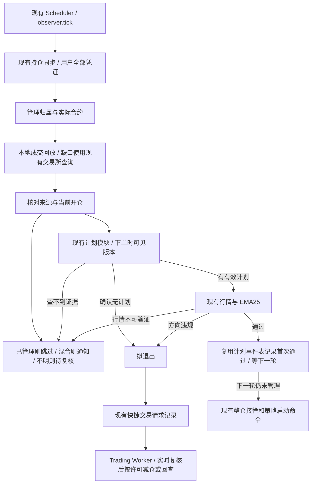

# 交易纪律修复设计

状态：待审核。适用范围是现有交易纪律模块和它在持仓、计划、快捷交易及 Worker 的接入点。先在本地隔离环境验收，实盘数据和开关不参与实现验证。

## 需求与现有偏差

| 业务规则 | 当前代码 | 预期修复 |
| --- | --- | --- |
| 遍历该用户所有账户，只判定交易所客户端手动开仓且未被管理的仓位 | 定时入口已遍历全部凭证，但手动来源依赖逐单环境变量。代码还有一条允许查加仓、按开仓满一小时处理的旧路径。 | 定时任务统一走最新的手动开仓流程。只有来源有可信证据才进入纪律判定。已管理仓位跳过，混入策略敞口只通知。 |
| 复用持仓同步，按实际合约判定 | 能读取 USDC 仓位，成交回放和退出却限制 USDT，计划查询也写死 USDT。 | 从仓位原生合约和产品目录取得实际结算币，回放、计划和后续动作使用同一产品。查不到或有冲突时待复核。 |
| 先查开仓当时有效的计划，再查已收盘 K 线的 EMA25 | 新路径已按该顺序。旧路径保留另一套判断。 | 只有可信且确认无计划，或确有计划但 EMA25 方向违规，才拟退出。查询失败和证据不足都待复核。币安永续用 4 小时，快捷开仓已有的股票 1 小时判定继续走原入口。 |
| 全部通过后留到下一轮，仍未管理才按原计划接管 | 新路径把首次通过写入本地专用表，旧路径另按开仓满一小时判断。 | 首次通过改存到现有计划事件表，以实际观察轮次为准。同一小时重复触发和重启都不提前接管。后续计划编辑、撤销或到期无需重新判定。 |
| 退出只减能确认归属的数量，超时重启后回查原订单 | Worker 通过回调观察流程再次查计划和 EMA25。关闭退出开关后，已提交的退出也不会回查。 | Worker 消费已有判定，只复核当前仓位、归属和可减量。开关控制新动作，已提交请求继续按原号只读查单并更新本地结果。 |

## 订单来源与仓位归属的证据

### 先定位当前开仓，再判断来源

1. 用同一用户、凭证、交易所、产品和原生合约关联仓位快照与成交。回放后多空数量须与快照一致。按当前方向定位最近一次从零开仓或反手开仓的成交，拿到成交号及对应交易所订单号。后续加仓不重新触发计划和 EMA 判定，但仍参与数量和归属核对。
2. 来源证据必须能指向**这笔开仓订单**。有订单和成交只能证明发生了开仓。要证明由客户端人工发出，还需要可验证的提交渠道证据。本地归属查询失败、记录缺失、账户不一致或两边证据冲突时，结果为待复核。

| 来源结论 | 需要的证据 | 得出结论后的动作 | 当前证据进度 |
| --- | --- | --- | --- |
| 原系统策略 | 同一账户、合约、订单号匹配本地执行绑定，且绑定指向有明确归属的策略实例或待执行订单 | 策略开的仓位跳过。有同一侧的手动与策略敞口时只通知 | 现有代码可识别部分已绑定系统订单，仍需对照真实样本 |
| 持仓管理 | 订单绑定指向具体管理策略，策略配置和同一仓位的管理登记能互相核对 | 已管理仓位跳过。已确认混合的仓位只通知 | 当前代码未单独分类，尚待验证样本和绑定覆盖 |
| 交易所客户端手动单 | 能把真实开仓订单与交易所提供的、可验证且 API 调用方无法伪造的人工客户端来源关联起来 | 未管理且归属可核对时才查计划和 EMA25 | **尚未找到经验证的自动识别依据** |
| 来源未知或证据冲突 | 只有交易所成交、只有客户端订单号前缀、没有本地绑定，或记录互相矛盾 | 待复核，自动退出和接管均不触发 | 第三方 API 单缺乏可信分类时也走此分支 |

币安文档允许 API 调用方指定客户端订单 ID。这个字段可用来回查同一笔订单，不能仅凭其前缀证明提交渠道。逐单环境变量用于模拟测试，线上不能用它自动认定手动来源。[币安 USDⓈ-M 交易 API](https://developers.binance.com/en/docs/catalog/core-trading-derivatives-trading-usd-s-m-futures/api/rest-api/trade)

**验收样本**。在隔离 Demo 环境分别记录网页或 App 手动单、QuantDinger 策略单、持仓管理单和第三方 API 单。每笔保留来源标签、原生合约、同笔订单及成交的脱敏编号、本地绑定结果和交易所返回的字段。再做两组反例：第三方 API 指定与手动单相似的客户端订单号，以及系统单本地绑定缺失。两组均不能被认成手动单。样本尚未采集。若最终没有可信渠道证据，自动识别不验收，未知仓位继续待复核。

## 首次通过记录与轮次

### 为什么需要持久化，是否要新建表

需要跨进程与重启保存两项事实：**这次开仓首次通过的观察轮次，以及通过时使用的计划版本**。只从成交时间推算等候窗口，会丢掉「实际观察后给人留一轮」的语义。每次重新匹配计划，也会让之后的计划编辑、撤销、到期改变已判定结果。内存可以缓存读到的结果，但进程重启后不能用它重建首次通过事实。

**建议复用 `qd_trade_plan_events`，无需为此新建表。** 现有表已经可以追加系统事件、保存 JSON 数据，并以外键把用户、计划和版本绑在一起。首次通过一定有匹配的计划版本，和该表的语义相符。现有 `qd_discipline_opening_passes` 是本地未提交实现，已在 VS Code 隔离库确认存在；本地记录的 `origin/main` 和已知的 10 月 25 日生产发布提交未包含它。生产库实际目录仍未确认。此前生产访问未通过，这次没有访问生产。参见 [现有表定义](../../backend_api_python/migrations/init.sql) 和 [计划事件读写](../../backend_api_python/app/trade_plans/repository.py)。

| 候选 | 适合保存什么 | 本次结论 |
| --- | --- | --- |
| `qd_trade_plan_events` | 已发生的系统判定及其计划版本，允许自定义事件类型，数据库原生支持追加和按主键查询 | **复用**。新增一种内部事件类型即可，历史计划的版本与状态不变 |
| `qd_account_positions`、`qd_position_reservations` | 当前仓位快照与归属数量。当前仓位表会被同步刷新，并删除已归零的仓位 | 作为判定输入。快照没有开仓成交级身份，储存通过记录会让它受同步和仓位替换影响 |
| `qd_execution_events` | 交易所订单和成交事实，也是执行消费者处理的输入 | 取其成交作为证据。手工写入纪律判定会混入交易所事实和消费者重试流程 |
| `qd_quick_trades`、`qd_strategy_commands` | 已登记的退出请求，或已有策略实例的启动命令 | 继续承担各自动作。首次通过时可能两种动作都未发生，不能用一笔虚构请求承载等待状态 |
| `qd_trade_plan_attempts`、`qd_trade_plan_links`、`qd_trade_plan_requests` | 实际计划执行尝试、业务记录关联、HTTP 请求幂等 | 沿用原有用途。首次观察通过不是某次执行、关联写入或 HTTP 请求 |

### 数据结构、写入时机与读取规则

| 内容 | 设计口径 |
| --- | --- |
| 事件类型与作用 | 在 `qd_trade_plan_events` 追加 `discipline_opening_passed`，`source=system`。事件自身记录计划 ID、版本 ID 和用户 ID，`occurred_at` 记实际观察时刻，`payload.passed_round` 记对应的 UTC 整点轮次。首次通过事件不改变计划生命周期。 |
| 同一次开仓的唯一身份 | 用版本化固定命名空间和顺序固定的字段生成确定性 UUID，作为现有主键 `id`。参与字段是用户、凭证、交易所、交易环境（Demo 或实盘）、市场类型、原生合约、方向和开仓成交号。只使用经过验证、规范化后的值，先核对凭证属于该用户。计划 ID、版本和观察时刻不参与去重。 |
| 什么时候写 | 建议复用现有自动接管开关，仅在开启接管的正常轮询中写入。来源确定为客户端手动、仓位未管理且归属明确，计划和 EMA25 均首次通过，并且满足接管起效范围时，在 Scheduler 中写一条。只读观察返回判定，但不写通过事件。当前本地实现即使关闭接管仍会写专用表，因此这里是待审核的行为调整。 |
| 哪些分支只读 | 已有通过记录、证据不足、已管理、混合持仓、无计划、EMA25 违规、行情缺失。混合持仓的通知路径独立。已批准的自动退出仍写现有 `qd_quick_trades`。 |
| 怎样安全重跑 | 在同一个数据库事务中按主键插入，使用 `ON CONFLICT (id) DO NOTHING`，随后按同一用户、事件类型和 ID 读回。并发时采用实际保存的轮次和版本。查库或写库失败时本轮待复核，不能重新计为已经通过。 |
| 后续怎么用 | 同一轮次返回等待。更晚的观察轮次重新核对当前开仓身份、仓位和管理归属，符合条件才按保存的版本接管。订单来源仍不明则待复核。平仓后再开使用新的开仓成交号，开始独立的一轮。 |
| 计划读取兼容性 | 新事件服务内部按主键读取。现有历史计划查询已只读取 `state_changed`。计划详情、网页和 Agent 事件列表也需要回归，确定内部事件不会混入现有公开列表。现有列表默认读取全部事件，实施时应过滤此内部类型，保持接口和页面输出。 |

例：10:27 开仓，11:00 首次通过并写入版本 v1。11:15 在同一小时重跑或重启后重读，结果仍是等待。12:00 再发现同一开仓且仍符合条件，才沿用 v1 发启动流程。如果跳过了 12:00，实际执行的下一轮可作相同核对。若期间平掉再开，新成交号不沿用前一条记录。

### 生产已有数据库怎么迁移和验证

以下是发布设计，尚未执行生产操作。

1. **确认前置表与权限。** 获得发布授权后，对实际生产连接执行只读目录查询。核对 `qd_trade_plan_events` 存在、`id` 是唯一主键、`payload` 为 JSONB、计划版本外键有效，运行 Scheduler 的角色具备这张表的 `SELECT` 与 `INSERT` 权限。也核对是否意外存在本地原型表。只查元数据，不将业务记录写进生产做验证。
2. **采用复用方案时。** 计划事件表和约束满足前置条件时，持久化改动只增加应用层事件类型。生产原库无需新增纪律表、字段、索引或回填。发布仍经过已有的严格数据库迁移服务，再启动新代码。若缺计划模块原表，应先用该模块的标准迁移补齐，并在隔离旧库演练。原型表即使存在也保持原状，先确认数据来源和用途，禁止直接把本地模拟记录导入生产。
3. **如复用验证失败且确需专用表。** 先补充复用失败的具体原因，经审核后使用同一个 `qd_discipline_opening_passes` 设计。新库的标准定义留在 `migrations/init.sql`，已有库使用幂等的带日期迁移文件，并在 `app/utils/db.py` 注册组件，由现有 `migration` 服务调用严格入口。迁移只新增该表及必要约束，不重建数据库，不用猜测值回填旧仓位。目标库已有同名表时，先核对字段、主键与约束，结构不一致时停止发布。相关流程见 [仓库迁移约定](../../backend_api_python/migrations/README.md) 和 [严格迁移入口](../../backend_api_python/app/commands/migrate.py)。
4. **先在隔离库验收。** 用历史版本结构建库，保留至少一条已有计划和计划版本，演练升级两次并断言旧数据不变。复用方案要覆盖首次写入、并发去重、同小时重启、跨轮、平仓重开、不同环境与账户、外键校验。还要在已存在新事件时，用候选版本和拟回滚版本分别查计划详情与事件列表，确认未知事件不会泄漏开仓身份或导致解析报错。若改走专用表，另验空库和旧库结构一致、重复迁移不覆盖已有记录。校验失败不得进行有写入的业务验收。
5. **批准上线后验收。** 先关闭新增自动动作，确认当前连接和备份可用于回滚。运行现有发布脚本中的严格迁移步骤，检查退出码和迁移日志，再用只读查询复核表结构和权限。先观察日志与旧计划接口。若有异常，停用对应纪律功能并恢复上一应用版本，保留已经写入的历史记录。原型表的清理和任何数据回填单独审核。

以下 SQL 用于书面验收。实际核对时使用 Scheduler 的数据库角色，并按目标环境调整 schema。表存在且权限均为真，还应看到主键 `PRIMARY KEY (id)` 和指向计划版本的联合外键。

```sql
BEGIN READ ONLY;
SELECT to_regclass('public.qd_trade_plan_events') AS plan_events,
       to_regclass('public.qd_discipline_opening_passes') AS prototype_table,
       has_table_privilege(to_regclass('public.qd_trade_plan_events'), 'SELECT') AS can_read,
       has_table_privilege(to_regclass('public.qd_trade_plan_events'), 'INSERT') AS can_append;
SELECT conname, pg_get_constraintdef(oid)
FROM pg_constraint
WHERE conrelid = to_regclass('public.qd_trade_plan_events') AND contype IN ('p', 'f');
SELECT data_type
FROM information_schema.columns
WHERE table_schema = 'public' AND table_name = 'qd_trade_plan_events' AND column_name = 'payload';
ROLLBACK;
```

**本次本地核验。** 我用当前已提交的 `HEAD` 版 `init.sql` 启动无网络、无端口的独立 PostgreSQL 18.3，确认测试库没有专用表。用原计划事件表写入两次同一开仓的通过事件，第二次故意给出不同轮次和计划版本，数据库保留了第一次的值。还确认了平仓重开、换凭证或换用户的事件 ID 都不同，按另一用户查询原记录为空。这只验证数据库结构和去重，未实现应用读写、迁移或接口兼容性改动。

### 本次发布测试范围

本版本仅启用指定用户的观察任务。经确认目标用户后，通过现有后端发布流程的 `discipline_observation_user_id` 参数配置已有环境变量。发布脚本先用只读 SQL 核对用户和计划事件表，创建并检查 PostgreSQL 备份。严格迁移完成后才设置观察，并在启动前后核实自动退出、自动接管和快捷开仓拦截均关闭。该参数为空时沿用原发布行为。

当前代码把首次通过改写为计划内部事件，公开计划事件查询过滤该类型。未提交的原型建表语句已移除，没有删除数据库里的任何表或历史记录。既有退出和接管的两个幂等索引通过标准迁移组件登记；观察发布不会触发这两条自动执行链。实盘外部单的手动来源仍待证据验证，手工标记仅对 Demo 或测试网生效，USDC 回放和旧分支收敛仍在后续步骤。

## EMA25 方向判定

### 比较哪两个数字

用**实际下单时间**作为截点，取同一产品截至该时点最后一根已收盘的 K 线。比较这根 K 线的收盘价 `C` 与包含该根 K 线计算出的 `EMA25`。委托价、成交价、当前报价和未收盘 K 线都不参与这个口径。此处沿用当前实现，若业务想比较下单价，需要另行确认并更新验收用例。

- 加密货币使用 4 小时 K 线。以北京时间举例，13:10 下单时取 12:00 已结束那根，13:10 还在形成的 12:00 至 16:00 K 线不参与。以现有行情时间与周期口径确定边界。
- 股票在快捷开仓入口使用 1 小时 K 线，按交易所会话判断已收盘时段，跨午休或休市不凭空补 K 线。
- 计算复用现有 `ema_series_sma_seed()`。首个 EMA 是前 25 根收盘价的均值，后续用 `EMA = 前一根 EMA + (本根收盘价 - 前一根 EMA) × 2 / 26`。当前代码最多使用 100 根，最近一根缺失、中间有缺口、连续数据不足 25 根或下单时间不可信时，返回待复核。参见 [EMA25 实现](../../backend_api_python/app/trade_discipline/ema.py) 和 [现有指标计算](../../backend_api_python/app/services/market/technical_indicators.py)。

| 样例 | 做多 | 做空 | 定时任务结果 |
| --- | --- | --- | --- |
| `C=101，EMA25=100` | 通过 | 违规 | 违规方向且其他条件满足时拟退出 |
| `C=99，EMA25=100` | 违规 | 通过 | 违规方向且其他条件满足时拟退出 |
| `C=100，EMA25=100`，或在当前计算容差内相等 | 当前实现拦截 | 当前实现拦截 | **当前代码将此归为违规并拟退出。等于均线时是退出还是待复核，仍待需求方确认** |
| 下单时间不明，或行情缺失、数据断档 | 待复核 | 待复核 | 不拟退出，日志写明缺失原因 |

前置条件是已经确认有匹配的有效计划。确认无计划直接进入拟退出分支。计划查询失败时止于待复核。两种情况的 EMA 调用次数都应为零。对照日志时至少核对 `submitted_at`、K 线收盘时间、收盘价、EMA25、订单方向和最终判定，便于复算。

## 当前待确认项

- 手动来源的正面证据须过 Demo 样本验收。样本即使看起来可区分，也要验证第三方能否模拟这些字段。
- EMA 以当前的 K 线收盘价对 EMA25 为基准供审核。等于均线的实盘处理待确认。
- 混合敞口的通知频率与是否跨轮去重尚未定。既有规则只确定混合仓位不自动处理。

无到期时间计划的近期口径也待确认。保留现有明确到期时间与可配置回看时长的规则。两者都缺失时继续待复核。

## 架构与复用



| 接入点 | 复用方式与改动限度 |
| --- | --- |
| `scheduler.main()`、`HourlyDisciplineObserver` | 继续用现有租约和后台线程。扫描、判定结果与后续动作在现有函数里明确交接。核对全部调用方和测试后移除定时入口中的旧分支，退出 Worker 改为直接复核证据。 |
| `list_position_inventory_accounts()`、`read_account_position_inventory()` | 复用现有持仓同步和管理登记。产品身份优先按交易所、市场类型和原生合约通过 `get_catalog_product()` 精确查询。归一化后的展示品种只辅助展示和查询。已有产品信息优先使用，并校验身份一致。 |
| `ExecutionEventRepository.resolve_binding()`、`read_position_evidence()` | 复用已有订单绑定和本地优先的成交回放。通过现有币安客户端补查；移除 USDT 字符串限制，由已确认产品决定路由。无证据与确认无业务记录保持可区分。 |
| `PlanService.match_at_order_time()`、`check_ema25_at_order_time()` | 直接传实际产品、方向和实际下单时间。回看规则和 EMA 算法保持现有实现。单独的快捷开仓守卫仍复用同一计划服务和 EMA 规则。 |
| `qd_quick_trades`、`submit_market_close()`、Trading Worker | 沿用原退出请求与客户端订单号。现有普通对账要求交易所订单号，超时缺交易所订单号时继续使用现有按客户端订单号回查链路。禁止重复提交。 |
| `qd_trade_plan_events`、`create_managed_strategy()` | 通过记录复用现有计划事件表。接管继续沿用接管键、原计划版本和策略启动命令，参数和当前仓位复核仍走现有流程。 |

## 配置与权限

继续使用现有观察、退出和接管开关及用户 ID。接管模板、起效时间、计划回看使用已有配置。把遗漏项补充到示例配置即可。默认关闭自动动作。观察仍覆盖该用户全部账户，凭证读取与执行均验证用户和凭证归属。实盘退出和接管提议共用 `LIVE_TRADING_ENABLED` 与各自纪律开关，执行前再次判断。Demo 验证只用 Demo 凭证。已经提交的订单允许按原账户、原合约和原客户端订单号继续回查，其路径只查询交易所并更新本地请求状态。无新增页面、配置表或权限角色。

## 关键伪代码

```text
Scheduler 到一个新观察轮次：
  对该用户的每个凭证，调用现有持仓同步
  对每个仓位：
    有管理登记就跳过，发现混合敞口则通知
    用原生合约确认产品，回放成交并核对当前方向和数量
    来源未知、证据不足或身份冲突 → 待复核
    确认是系统、策略或持仓管理订单 → 跳过
    确认是客户端手动开仓：
      若已有首次通过记录：
        同一轮 → 等待
        新一轮仍未管理 → 拟按原计划接管
      否则：
        查下单时已存在且有效的计划
        确认无计划 → 拟退出
        查计划失败 → 待复核
        有计划 → 查下单时最近已收盘的 K 线和 EMA25
          方向违规 → 拟退出
          行情不可用 → 待复核
          通过 → 已开启自动接管且在起效范围内时，追加现有计划表内部事件
  动作开关与权限满足时，登记退出请求或调用现有整仓接管

Trading Worker 领取退出请求：
  已保存提交状态 → 按原账户和客户端订单号只读回查
  待提交且权限、租约与本轮有效性都满足：
    复核仍是原开仓，仓位未被管理且可减量有归属证据
    若加仓、新开仓、反手或证据冲突 → 暂缓
    数量取拟退出上限和当前可证实剩余量的较小值
    持久化原客户端订单号 → 调用现有快捷平仓 → 更新结果
```

## 分步验收

| 步骤 | 输入与验收结果 |
| --- | --- |
| 1. 产品身份 | 同标的 USDT 和 USDC 的本地模拟仓位。两者都可回放且只匹配自己的计划。目录缺失或身份冲突时待复核，退出请求不会路由到另一合约。 |
| 2. 唯一定时主链路 | 两个账户并存。可信手动单进入判定，策略、管理及已管理仓位跳过，混合仓位只通知，第三方与证据冲突待复核。模拟数据只证明分流；Demo 还要覆盖同前缀的 API 单和缺失本地绑定的系统单。 |
| 3. 计划和 EMA 顺序 | 无计划或计划失败时 EMA 调用次数为零。分别验证上方、下方、相等、K 线断档和正好收盘的时间边界。符合写入条件时，首次观察通过写一条计划事件。只读观察不写，同小时重跑与重启不改原值，跨轮拟接管，平仓重开用新的成交号。 |
| 4. 退出与权限 | 模拟部分成交、重复触发、超时及重启，核对只减可归属数量与同一个客户端订单号。关闭全局或退出开关后，新实盘请求没有发送，已提交记录仍能回查。 |
| 5. 接管与接口回归 | 下一轮才能接管。余单、仓位变化、越权和开关关闭均拦截。重复触发只返回原实例。模拟 Worker 领取启动命令。原快捷开仓、减仓及平仓入口回归。 |

每步先用模拟数据单独验证，再在隔离 PostgreSQL 分进程复查受影响的持久化和并发场景。完成后逐项报告实际结果及剩余证据缺口。
