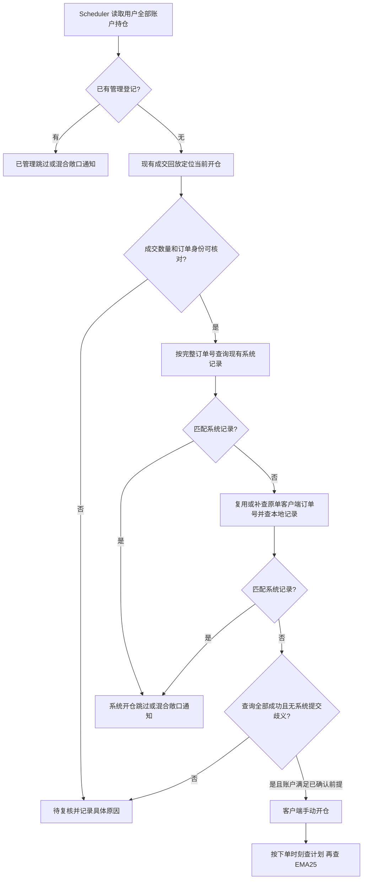
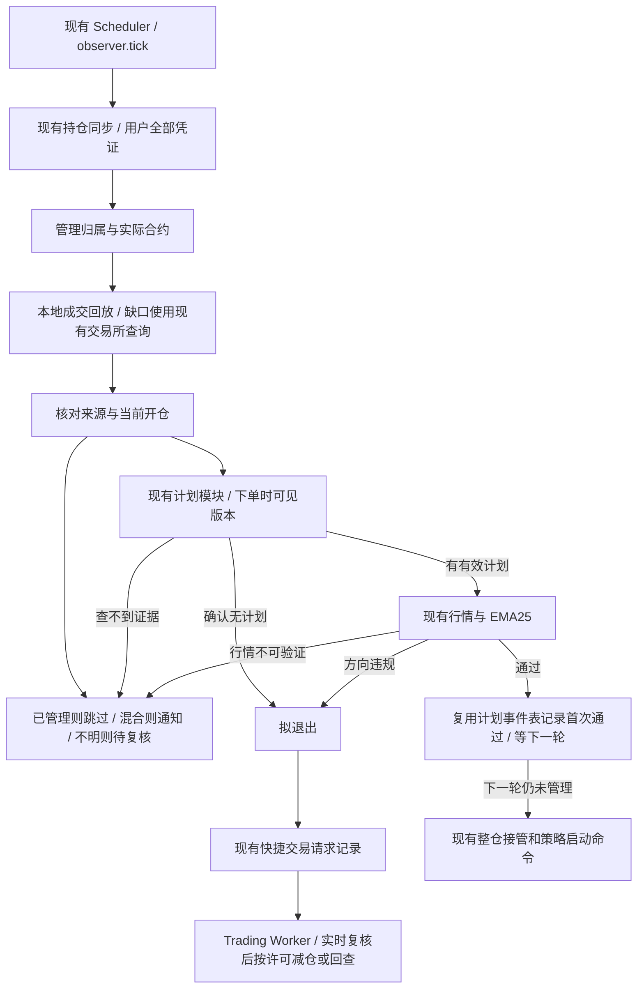

# 交易纪律修复设计

## 最新确认的业务规则

需求方在本轮流程复核后明确以下规则，覆盖下文此前标记为待讨论的相应项。

- EMA25 相等视为满足方向条件，多空均通过该项。
- 有效计划只认实际下单时已经处于“观察中”的计划。用户已确认按进入观察中的时间计算一天，计划即使两天前创建、今天才进入观察中，今天开仓时仍算近期。多份匹配按最近进入观察中的时间排序，修改内容不会自动刷新这一时间窗口。
- 管理策略启动失败通知人工处理，保留原实例，不自动创建新实例或重试启动。人工主动停止继续按原系统的停止流程处理。
- LLM 使用固定业务提示词，读取首次通过时保存的原计划版本，从计划内容提取持仓管理参数。计划文字中的明确止损可以用于提取，无需强制用户事先写入结构化止损字段。结构化与文字止损冲突、缺失或含糊时待复核，保留原文证据用于核对。
- 正式流程仍为首次检查通过、人工介入窗口、下一轮仍未管理则接管。“观察通过后开启接管”是测试开关带来的实现分支，不新增为用户业务流程。现有测试开关按原调试用途保留。

两处退出恢复问题属于原平仓流程的异常分支。例如人工开多后确认无计划，系统发起平仓，原平仓单被交易所撤销或过期且零成交，仓位仍存在；当前幂等处理会阻止后续轮询继续退出。另一例是系统先保存退出请求、尚未发送就被重启，之后持续查询一个可能尚未发出的原订单。它们须在确认原请求结果的前提下补齐恢复，不能把未知状态当成可重复下单。本轮先落实已经明确的业务判断、参数提取和启动失败通知。

启动失败通知复用现有策略命令和站内通知表。通知查询限定本用户、本账户已由纪律接管的策略，仅识别最近启动命令失败，或实例创建后尚未生成启动命令就失败的情况。最近命令为人工停止时跳过。相同策略和失败命令只发一条站内通知，通知失败留待下轮，不自动启动策略。即时启动失败在接管返回时检查，异步 Worker 失败在下一轮持仓同步时检查。文案使用现有通知本地化资源。

最新确认后的隔离 PostgreSQL 回归为 **466 项通过**，通知本地化及既有持仓管理相关回归 **243 项通过**。独立 Scheduler 与 Trading Worker 的完整模拟链路已再次复验通过。LLM 当前生成的实际接入参数为固定止损价，其余管理参数继续使用已配置策略参数。近期以进入观察中的时间计算，默认窗口 24 小时，多份匹配按该时间降序选择最新有效计划。

两处恢复缺口继续沿用同一退出流程修复：确认原平仓单零成交终止后，下一轮仓位仍存在且仍符合退出条件时，用原逻辑请求推进一次新的退出尝试。仅当原单已有明确终态、交易所订单号和零成交数量时允许进入该分支。当前提交结果仍不明确时，只回查原单并通知人工，保持不重复提交。每次尝试使用不同客户端订单号，历史尝试保存在原请求 JSON，不新增表或字段。

状态：2026-11-27 需求方已同意保留客户端订单号、排除系统订单、接回现有纪律流程及重新验收的方向，要求列明实施计划，未决内容及时讨论。已确认全部监控账户除 QuantDinger 策略、持仓管理和快捷交易外，其他开仓均来自交易客户端人工操作，账户未接第三方机器人、跟单或其他自动下单程序。USDC 产品链路和来源判定已完成本地修复，定向回归及独立 Scheduler、Worker 模拟验收已通过。EMA 相等通过、启动失败人工处理、固定提示词提取文字止损已实现；近期与最新均已明确按进入观察中的时间计算，窗口默认 24 小时。

## 本轮实施计划

按下表顺序推进。每步产出具体代码位置、输入样本、实际返回、日志和测试结果，再更新本节状态。后续步骤复用已通过的结果，发现失败先修复并重跑受影响项。影响交易行为的未决事项须获得明确答复，独立的数据传递和归属查询工作可以继续。

| 步骤与当前状态 | 调整范围与复用 | 可独立验证的完成条件 |
| --- | --- | --- |
| 1. 订单身份完整传递，已实现并模拟验证 | 调整持仓同步的币安挂单转换与成交回放输出。复用已有成交表、原订单响应、`get_order()` 和原生合约规范化。保留完整 `orderId`、`clientOrderId`、下单时间、账号及合约身份，日志只保留需要排查的脱敏标识 | `ios_im_` 样本从原响应进入标准字段，再进入当前开仓事件，完整值不变。本地证据齐全时新增查询为零，缺字段才补查原单。错误账号、错误合约、下单时间冲突均不可进入纪律判断。覆盖 USDT 和 USDC |
| 2. 实际来源分类，已实现并验证真实 SQL | 调整 `opening_order_origin()`，只读复用绑定、待执行、网格与快捷交易记录，按完整号码及同一账户合约匹配。核对其余可达 Binance 开仓入口与重试路径。发现发单前身份缺口，先明确并修复该接入点 | 通过真实分类函数及现有表验证手动与系统单并存。绑定缺失、接单后超时、原单号未回写时，已保存的客户端订单号仍能排除系统单。查库失败、冲突、未确认系统提交给出具体待复核原因。完整来源函数不能被直接替换为 `manual` |
| 3. 接回 Scheduler 纪律主流程，已按确认的时间与 EMA 边界修复 | 复用全部账户持仓同步、历史计划匹配和 EMA25。已管理先处理，混合只通知，开仓判定只执行一次。首次通过继续写现有计划事件表，保存原计划版本 | 无计划当轮拟退出，有计划才调用 EMA。违规拟退出，查询失败待复核。首次通过等下一实际观察轮，重启及同轮重跑保持原轮次。后续计划修改、取消、到期均沿用首次通过的原版本。等于均线、无到期计划按确认后的规则验收 |
| 4. Worker 退出恢复，已修复并分进程验证 | 复用现有快捷平仓、退出请求和客户端订单号。执行前核对仍为同一开仓、未被管理、同一产品及可归属数量。审计现有 Worker 是否重新判断已冻结的开仓计划和 EMA，并按既定需求修正 | 部分成交只更新原请求，超时重启按原号查单，重复轮询不重复提交。观察后加仓、反手或身份变化时暂缓本请求。动作开关关闭后新动作拦截，已提交请求继续只读回查。USDT 和 USDC 分开核对 |
| 5. 按原计划接管与实际启动，已补齐文字止损及启动失败通知 | 复用整仓接管、策略命令和 Worker 启动机制。核对当前 LLM 模板选择及参数提取是否满足原需求。原实现仅提取固定止损价的限制必须列明，不能作为完整计划适配已完成来验收 | 下一轮仍未管理且没有冲突余单才接管。同一开仓重复触发仅有一个实例，启动失败找回原实例。用模拟计划及模拟 LLM 响应验证参数来自保存版本，含糊、失败或非法参数有明确处理。Worker 实际领取命令并进入现有管理策略启动流程 |
| 6. 完整验收与发布准备，隔离验收已通过，生产阶段待完成 | 本地隔离 PostgreSQL、独立 Scheduler 与 Trading Worker、模拟交易所。随后用已有真实账户只读核对入口。复用已有发布与迁移机制 | 分进程测试验证订单字段、来源、计划、EMA、首轮记录、下一轮接管、部分退出和重启恢复。真实账户观察核对每个账户与具体分支。交付实际结果、未验证项、镜像版本、数据库变更及开关清单，再按确认范围进行生产部署测试 |

### 当前已完成与尚待验证

- 已只读核对到一笔真实 `TRXUSDC` 历史订单，`clientOrderId` 以 `ios_im_` 开头，历史与单笔查询一致。此证据证明字段存在。样本的开仓或平仓性质须结合成交回放判定。
- 已定位两处字段传递缺口，并核对普通策略、网格及快捷开仓的发单前记录。来源修复已经实现，使用实际分类函数和隔离 PostgreSQL 验收。
- 上一轮 USDC 相关回归为 387 项通过，其中来源分类被模拟。该数字保留为上一轮证据，本轮完整来源验收另行报告。
- 本轮已实施最新确认规则并完成隔离模拟。当前没有阻塞观察发布的未决业务口径。生产部署、开关和运行状态以发布阶段实际核对为准。

### 已讨论并落实的内容

| 事项 | 当前代码或缺口 | 本轮处理方式 |
| --- | --- | --- |
| 收盘价等于 EMA25 | 用户已确认满足条件，代码已改为多空返回 `allowed` | 已落实并验证 |
| 近期计划 | 用户已确认一天内、最新的观察中计划，示例配置为 24 小时 | 已明确按进入观察中的时间计算 24 小时，按该时间降序匹配，修改版本不刷新窗口 |
| 来源配置 | 设计中建议新增外部单按手动识别的环境变量，默认关闭，作用于已配置用户全部账户 | 已实现 `TRADE_DISCIPLINE_EXTERNAL_OPENINGS_AS_MANUAL=false`，作用于已配置用户全部账户，Scheduler 与 Trading Worker 一致配置。需求方已确认账户使用前提，来源开关不能替代查询完整性核对 |
| LLM 管理参数 | 已使用固定中文提示词，从原计划的结构化字段或文字提取明确止损，并核对原文证据 | 当前真实接入仍是固定止损参数，其余参数沿用既有管理策略配置。模型缺少明确价格或原文证据时待复核 |

### 各步日志与结果交付

沿用现有日志机制，关联观察轮次、用户、凭证、原生合约和开仓身份。每步必须能看到输入来源、是否使用本地证据或原单补查、系统归属命中依据、计划版本、K 线收盘时刻、EMA 数值、分支原因及后续请求或策略实例。提前返回要记录原因。密钥和签名不进入日志。

每步验收报告列出修改文件与函数、实际测试输入、预期与实际结果、尚未验证的范围和下一步依赖。发现需要更改上述业务规则时，先更新对应设计并讨论，获得明确结论后继续相关实现。

## 2026-11-27 整体业务流程复核（修复前记录）

本轮按需求方要求只读检查业务代码，并用临时合成用例复核异常分支。以下记录当前行为和待决定事项，未调整业务代码、数据库结构、运行开关或生产服务。此前 443 项回归及分进程验收仍作为相应测试范围的证据，以下遗漏分支须补入后续验收。

### 主流程与已确认规则的对应

| 环节 | 当前实际行为 | 核对结果 |
| --- | --- | --- |
| Scheduler 触发 | 每到下一 UTC 整点启动一轮，上一轮未结束时跳过。遍历配置用户的全部交易所凭证 | 符合每小时观察的安排。正式环境须核对 `TRADE_DISCIPLINE_SYMBOLS` 为空，现有品种过滤配置若有值会缩小观察范围 |
| 持仓同步与归属 | 调用原有持仓快照与策略登记。已有登记先跳过，登记数量不足时通知 | 复用入口正确。但“登记存在”和“管理策略正在运行”目前是两个不同状态，启动失败与人工停止的处理待明确 |
| 当前开仓与来源 | 本地优先成交回放，按真实产品补查。完整交易所订单号及客户端订单号查已有系统记录。系统单跳过、混合只通知、缺证据待复核 | 符合客户端人工开仓范围。USDT 与 USDC 保持独立，iOS 前缀作为来源线索 |
| 历史计划 | 使用实际提交时刻之前的计划版本及生命周期，只接受当时为 `observing` 的同产品同方向计划。多份匹配时按版本创建时间降序返回第一份 | 时间与产品隔离符合要求。草稿是否算有效、近期时限、多计划优先级还需业务结论 |
| EMA25 | 确认有计划后查询下单前最后一根已收盘 K 线，加密货币 4 小时。以上方做多、下方做空判定 | 正常方向符合要求。等于均线时现有代码仍判违规，未获明确业务确认 |
| 首次通过与下一轮 | 开启接管且有对应方向模板、在起效时间内时，才写现有计划事件，冻结计划版本。更晚观察轮拟接管 | 正常接管流程符合要求。观察模式不保存通过记录，后续开关打开的处理待明确 |
| 退出 | 保存原判断与客户端号码，Worker 复核原仓位及可归属数量。超时按原请求查单，关闭执行开关后已提交请求仍回查 | 已覆盖部分成交及接单后超时。零成交终止与保存已提交状态但尚未发送的窗口仍有恢复缺口 |
| 接管和启动 | 用配置的固定源码版本、LLM 提取的固定止损生成参数，复用整仓接管、命令领取和策略启动 | 实例及命令去重已验证。固定提示词已确认，实际策略选择与参数范围待明确。登记后启动失败会在后续轮询被视为已管理 |

### 明确的实现缺口

1. **退出原单零成交终止后停在旧请求。** `exit.py::queue_observed_exit()` 用开仓及尾笔成交生成幂等键，只允许更新 `discipline_queued` 记录。交易所原单若 `CANCELED` 或 `EXPIRED` 且成交为零，尾笔成交未变。下一轮返回 `existing`，无法继续退出。临时合成用例已复现这两个终态。后续修复必须区分已确认终态和仍不明确的提交，保留逻辑请求的幂等及原单证据。
2. **持久化已提交状态之后、真正调用交易所之前的中断。** `_process_exit()` 先写 `discipline_sent`，再检查许可并调用交易所。如果这个窗口中断或许可关闭，可能没有实际请求。后续会持续按原号码查询。查询不到时当前只记警告，尚无完整的恢复结论与可识别通知。此处不能把查不到直接当成允许再次下单。

### 必须讨论的业务口径

| 事项 | 当前代码具体行为 | 需要需求方明确 |
| --- | --- | --- |
| EMA 相等 | 包括相对容差 `1e-12` 内相等，多空都为 `blocked`，有计划也可能拟退出 | 按违规退出，还是本轮待复核 |
| 有效计划的状态与近期 | 只有下单时已经进入观察状态的计划可以匹配。草稿不会匹配。无到期计划且未配置回看时长时返回不可判断；有到期时间的计划目前按到期时间判有效 | 是否保留观察状态要求；无到期计划的近期时限；有到期时间但创建很久的计划是否仍按有效期使用 |
| 同产品同方向多份有效计划 | 当前取版本创建时间较新的一份，后续接管会使用该版本的参数 | 是否采用此优先级，还是多份匹配时待复核或指定关联 |
| 管理策略及参数 | 实际策略由环境变量按方向固定配置。LLM 只提取止损，并要求与 `risk_inputs.stop_price` 的结构化值一致。计划仅有文字止损时也会拒绝接管 | 固定提示词下，实际策略是否固定；LLM 应处理哪些管理参数；是否允许从明确的文字计划中提取尚未结构化的止损 |
| 已登记但启动失败或停止 | 管理登记查询不按策略运行状态过滤。策略即使 `stopped` 仍算已管理。正常轮询跳过，找回原实例也不会自动再发启动命令 | 初次启动失败是自动重试原实例还是通知人工；人工主动停止与启动失败必须分别处理 |
| 观察模式通过后开启自动接管 | `apply_poll_window()` 在接管关闭、没有模板或开仓早于起效时间时不保存首次通过。开启后才可能重新判断和记录轮次 | 观察模式是否也应冻结首次通过；打开自动接管后是否允许处理已有仓位，以及人工窗口从哪一轮计算 |

本轮已向需求方询问 EMA 相等、有效计划及启动失败策略。固定提示词已确认，实际管理策略是否固定的询问仍待答复。其余事项在此完整列明，未经明确结论不自行选取业务分支。

### 本轮临时复核结果

四项合成检查均复现当前行为，分别为零成交撤单后下一轮仍命中旧请求、零成交过期后相同行为、接管启动失败后找回同一停止实例且没有第二次启动请求、关闭接管时不保存通过记录。它们是当前行为的复核证据，不能当成上述业务缺口已经修复。

## 当前需求与实现

| 业务规则 | 当前实现 | 验证范围 |
| --- | --- | --- |
| 遍历用户全部账户，只处理未管理的客户端人工开仓 | 复用全部凭证持仓同步和只读订单归属查询。系统单跳过，混合敞口通知，缺证据待复核 | 实际来源函数及 PostgreSQL 订单记录已覆盖系统、人工、超时及缺绑定场景 |
| 按真实产品回放与判断 | 复用目录和交易所合约信息确认原生合约，USDT 与 USDC 分别处理 | 同标的两份合约的成交、计划、行情、退出已分别验证 |
| 先计划，再 EMA25 | 只查下单时已经进入观察中的计划，以进入观察时间计算默认 24 小时并按该时间降序取最新有效计划。有计划后查已收盘 K 线，EMA 相等通过 | 覆盖旧计划新进入观察、修改版本不刷新窗口、24 小时边界、多计划排序、方向及行情缺失 |
| 首次通过后留出人工窗口，下一轮仍未管理才接管 | 首次通过写现有计划事件并保存原版本，同轮或重启不提前接管，后续计划变更不重新判定。LLM 固定提示词从原计划提取止损 | 已覆盖原版本读取、轮次恢复、重复实例去重。当前自动提取的实际参数是固定止损，其余使用既有策略配置 |
| 退出只减可确认数量并保留原请求恢复 | Worker 复核原仓位和归属后减仓。明确零成交终止后可在下一轮继续同一逻辑请求，结果不明持续查原单并通知人工 | 覆盖部分成交、超时、重启、关闭执行开关、零成交终态与未知提交 |
| 管理启动失败通知人工 | 即时失败和后续命令失败复用站内通知，同一失败记录只通知一次，保留原实例 | 覆盖启动失败、人工停止、通知去重及用户隔离 |

## 订单来源与仓位归属的证据

### 先定位当前开仓，再判断来源

1. 用同一用户、凭证、交易所、产品和原生合约关联仓位快照与成交。回放后多空数量须与快照一致。按当前方向定位最近一次从零开仓或反手开仓的成交，拿到成交号及对应交易所订单号。后续加仓不重新触发计划和 EMA 判定，但仍参与数量和归属核对。
2. 来源判定限定同一用户、凭证、交易所、环境、产品和原生合约。先按交易所订单号查询本地系统记录，没有结果时，复用现有 `get_order()` 补齐同一订单的 `clientOrderId`，按完整号码查发单前的本地记录。所有查询成功且可以排除系统单时，按需求方确认的使用前提认定为客户端手动开仓。归属查询失败、身份冲突、历史记录缺失或存在无法排除的系统提交时待复核。

| 来源结论 | 需要的证据 | 得出结论后的动作 | 当前证据进度 |
| --- | --- | --- | --- |
| 原系统策略 | 同一账户、合约的完整交易所订单号或客户端订单号匹配绑定、普通策略待执行记录或网格订单记录 | 策略开的仓位跳过。有同一侧的手动与策略敞口时只通知 | 已核对普通策略、网格的发单前记录。完整异常场景仍需验证 |
| 持仓管理 | 订单绑定指向具体管理策略，策略配置和同一仓位的管理登记能互相核对 | 已管理仓位跳过。已确认混合的仓位只通知 | 当前代码未单独分类，尚待验证样本和绑定覆盖 |
| 交易所客户端手动单 | 账户满足已确认前提，当前开仓成交已核对，订单身份完整，全部本地归属查询成功且均无匹配，也无无法排除的系统提交 | 未管理且数量归属可核对时查计划和 EMA25 | 本次待实现与验收 |
| 来源未知或证据冲突 | 查询失败、身份不完整、历史覆盖不足、存在无法排除的系统提交，或匹配记录互相矛盾 | 待复核，日志写明具体原因 | 按异常处理，不归类为手动 |

客户端订单号采用完整值和本地已持久化记录关联。前缀相似没有归属效力。方案采用已确认的账户使用前提，后续若接入第三方自动交易，须调整该账户的来源策略。逐单环境变量可保留作 Demo 测试工具。

### 2026-11-27 原始调查与规则修订

- 在已核对的公开 REST 契约中，`GET /fapi/v1/order` 返回订单号、客户端订单号、下单时间、类型和执行状态。`GET /fapi/v1/userTrades` 返回成交与对应订单号。两份返回字段都没有区分网页、App 和外部 API 的提交渠道。`POST /fapi/v1/order` 允许 API 调用方自定义 `newClientOrderId`，所以即使 Demo 样本的客户端订单号长得不同，前缀也无法用于自动平仓归属。[币安 USDⓈ-M 交易 API](https://developers.binance.com/en/docs/catalog/core-trading-derivatives-trading-usd-s-m-futures/api/rest-api/trade)
- 本地调试实例核对到一个实盘凭证和零个 Binance Demo 或测试网凭证。原方案把人工渠道证明作为前置条件，导致真实外部开仓全部待复核。该前提由实现方额外引入。需求方随后明确账户没有第三方自动交易，本修订按系统订单排除和已确认使用前提实现。真实客户端样本的字段已只读核对，当前完整业务流程以隔离模拟验收为准。

### 2026-11-27 实际 iOS 订单字段核对

需求方指出客户端订单号可能含 `ios` 前缀后，对本地已配置账户进行了只读检查。以下仅列订单字段，账号密钥和完整订单标识不写入文档。

| 位置 | 实际结果 |
| --- | --- |
| 本地 `qd_execution_events`、`qd_quick_trades`、`pending_orders` | 当前均无币安记录，无法直接从本地历史表展示来源字段 |
| 币安 `GET /fapi/v1/allOrders`，`symbol=TRXUSDC` | 查到一笔已成交 SELL 订单，时间为北京时间 2026-11-26 22:56:19.694，交易所订单号尾号 `196044`，`clientOrderId` 长度 27，前缀 `ios_im_` |
| 同笔 `GET /fapi/v1/order` | 包含 `clientOrderId`，完整值与历史列表返回一致 |
| 同笔 `GET /fapi/v1/userTrades` | 查到一笔成交，返回项无 `clientOrderId`，需要通过订单号关联原单 |
| `account_snapshot.py::_parse_binance_orders()` | 输出保留 `orderId`，没有把原响应的 `clientOrderId` 放入转换结果 |
| `position_evidence.py::read_position_evidence()` | 原单查询结果只提取下单时间，没有把 `clientOrderId` 交给开仓来源分类 |
| 私有成交流 `normalizers.py::parse_binance()` 与 `ExecutionEventRepository.ingest()` | 代码会将 `o.c` 传入 `client_order_id` 并写库，本次数据库没有实际成交流样本可验证 |

上述订单和持仓同步链路直接使用原生 REST 客户端。本次确认的字段缺失发生在本项目的转换和回溯输出中。此前仅从公开字段契约推断无法使用客户端来源线索，遗漏了真实订单样本核对。

来源修复应保留 `clientOrderId`，优先复用已保存的私有成交流或原订单字段，缺失时按订单号补查。`ios_im_` 在当前账户的实际订单中已得到观察，可作为客户端来源线索写入日志，并结合完整号码的本地系统归属核对使用。在已确认没有第三方自动下单的业务前提下，其他客户端前缀仍按系统排除规则处理，避免将全部手动开仓限制成 iOS 开仓。来源修订验收增加原始 `ios_im_` 字段从原单、转换到开仓事件和分类的连续传递用例。该核查只执行 GET 查询与本地 SELECT，未更改来源业务代码。

### 来源修复的复用与调用

| 已核对代码 | 现有行为 | 来源修复如何使用 |
| --- | --- | --- |
| `pending_orders/submission_recovery.py::_prepare_submission()` | 在调用交易所前提交 `pending_orders.client_order_id`，随后尝试登记绑定 | 回写交易所订单号失败或绑定登记失败时，仍按客户端订单号匹配原待执行单 |
| `grid/engine.py::_place_limit()` 的 `reserve_pending()` 调用及 `grid/resting_orders_repo.py::reserve_pending()` | 先保存含客户端订单号的网格记录，再调用交易所，绑定登记在接单后 | 查询 `qd_grid_resting_orders`，关联策略所属用户和凭证。绑定缺失不直接归为手动 |
| `routes/quick_trade.py::place_order()` | 开仓在调用交易所前写 `qd_quick_trades`，保存客户端订单号。结果回写后登记绑定 | 同时查历史表，覆盖提交超时、交易所订单号为空的系统快捷开仓 |
| `position_evidence.py::read_position_evidence()` | 本地优先回放成交，缺口查订单。已同时保留下单时间和完整客户端订单号 | 将经过账户、合约、订单号核对的客户端订单号保留到同一开仓事件，已有信息直接复用，缺口才补查 |
| `manual.py::opening_order_origin()` | 已使用完整交易所与客户端订单号核对现有系统记录，按账户使用前提识别外部单 | 增加完整客户端订单号匹配及成功查无记录的分支，返回分类依据 |
| `execution_streams/repository.py::resolve_binding()` | 查不到时可能发现旧记录并调用 `register_binding()` 写库，且部分分支会过滤已删除策略 | 来源观察采用现有表的限定范围只读查询，避免观察过程补写归属。已保存的绑定仍是系统证据。已核实策略删除会清理绑定及订单，清理后仍带本系统 broker 标识的订单转待复核 |

以上调查证明三个主要开仓入口已有发单前记录。其他仍可触发的 Binance 开仓调用、重试阶段和历史清理路径须在实施时逐一核对。发现实际可发单却不留身份的路径，先修复该路径的记录，再开放该范围的外部单分类。

### 具体判断顺序



普通策略与持仓管理策略均通过现有策略发单流程记录订单，本纪律模块对两者都执行系统单排除。已管理仓位在最前面处理。同一侧后续加仓仅核对归属，发现系统与人工混合只通知。后续加仓不重新查计划和 EMA。

```text
classify_opening(scope, opening):
  查绑定、待执行订单、网格和快捷交易记录，按完整交易所订单号核对
  若存在匹配且归属一致 → 返回 system，携带命中表和记录号
  若查询失败或证据冲突 → 返回 unknown，携带失败原因
  若开仓事件缺客户端订单号 → 复用现有客户端查询同一笔交易所订单
  校验返回合约、交易所订单号、下单时间和客户端订单号
  用完整客户端订单号再查现有本地订单记录
  若存在匹配且归属一致 → 返回 system
  若查询失败、身份缺失或存在无法排除的系统提交 → 返回 unknown
  若账户允许按已确认的使用前提识别外部单 → 返回 manual
  否则 → 返回 unknown
```

### 配置、数据与异常边界

- **数据库结构边界。** 需求方要求尽量复用现有结构。本次 `clientOrderId` 来源修复复用已有 `client_order_id` 列及原有 JSON 字段，不增加来源表、字段、字段长度或历史数据批量回填。REST 补查先作为本轮订单证据传递，需要随已发生的纪律动作保留审计身份时使用现有业务记录的 JSON 元数据，具体键和写入时机随实现列明。
- **已有字段的版本来源。** Git 历史显示，`pending_orders`、`qd_live_order_bindings`、`qd_execution_events` 和网格订单的客户端订单号定义由 `e64e1c227bf3174e441a42143620179b286387e1` 引入，提交日期为 2026-08-03。快捷交易表增加该字段的定义由 `7d2c648723280b6e558456cbafbe071d996b8ee9` 引入，提交日期为 2026-09-26。本地记录的 `origin/main` 已包含这些定义。提交日期描述代码历史，生产实际执行迁移的时间须查目标数据库迁移记录。
- **已有执行索引须单独列明。** 当前交易纪律改动还包含 `uq_strategy_discipline_adoption` 与 `uq_quick_trade_discipline_exit` 两个唯一索引，分别保护接管实例和退出请求的幂等。这两项与本次客户端订单号字段传递修复分开核对，在发布清单中明确其定义和目标库现状。
- 建议新增一个环境变量 `TRADE_DISCIPLINE_EXTERNAL_OPENINGS_AS_MANUAL=false`，控制已配置用户的全部监控账户。默认延续现有待复核行为。本用户确认的账户场景使用 `true`。观察、退出和接管的权限及开关继续复用。启动和每轮日志均记录此来源规则的实际值。
- 来源分类复用现有四类订单记录，不新增表。来源结果先写入观察报告和现有执行请求的元数据，首次通过继续复用计划事件表。日志包含用户、凭证、环境、原生合约、开仓订单、命中记录及返回原因。
- 使用从本次修复生效后产生的新开仓作自动执行验收，沿用现有退出和接管起效时间。旧订单若本地历史已清理或有覆盖缺口，不能因查无记录就归为手动。时间边界只限定适用范围，不能代替订单路径覆盖验证。
- 本地存在同账户同合约的未确认系统提交、客户端订单号丢失，且无法与本次开仓排除关联时，本轮待复核。继续保留下一轮查询和原系统对账恢复。正常已核对系统单和手动单并存时，分别按具体订单分类。
- 订单号相同但账号或 USDT、USDC 合约不同不能相互命中。匹配不依赖订单号前缀，不因本地绑定缺失、策略停止或策略删除而直接改变来源。

### 本修订验收条件

1. 采用实际 `opening_order_origin()` 与现有订单表运行分类，端到端用例不再直接注入 `manual` 返回值。
2. 客户端人工开仓与系统策略开仓并存，人工进入计划和 EMA，系统单跳过。已管理仓位跳过，混合敞口只通知。
3. 策略、快捷交易、网格各模拟交易所接单后超时，本地只有客户端订单号且无绑定，仍识别为系统单。
4. 绑定缺失但原始订单仍在、策略已停止或删除但绑定仍在，仍排除系统单。查询报错、身份冲突或未确认系统提交返回待复核。
5. 同品种 USDT、USDC、不同用户和不同凭证不会串归属。关闭外部单识别配置时，外部仓位继续待复核。
6. 本地完整通过后，先用真实客户端开仓只读观察，核对实际来源和分流日志，再按已授权发布流程交付。测试范围和未验收项逐项报告。

## USDC 合约修复细节

1. Scheduler 按仓位快照的原生合约分组。成交回放优先查同一交易所、同一 `swap` 市场、同一原生合约的现有产品目录。目录同步当前只纳入 USDT 报价，因此目录无记录或缺结算币时，复用该账户环境的 `get_symbol_filters()`。币安 `exchangeInfo` 必须返回同一原生合约，且 `contractType` 为 `PERPETUAL`，`baseAsset + quoteAsset` 等于原生合约、`marginAsset` 等于报价币。已有目录身份与快照或报价冲突时停止。目录和交易所都无法确认时记录 `product_identity_unavailable`，本轮待复核。
2. 计划传入已核对的币对、原生合约和结算币。EMA 使用同一币对及 `swap` 市场。明确指定币对的币安永续行情只请求该币对，缺行时交由现有 EMA 缺行情分支处理，避免 `BTC/USDC` 被换成 `BTC/USDT`。
3. 退出请求仍写进现有 `qd_quick_trades`。使用已确认产品的标准币对与原生合约做队列身份和执行前仓位复核。同币种的两份合约分别生成原有幂等键。重启仍按原请求和客户端订单号回查。

```text
按原生合约取产品目录
若目录无记录或缺结算币，则按该账户环境查交易所公开合约信息
若身份缺失或冲突，则待复核
否则以同一个产品回放成交、匹配计划、查询行情和登记退出请求
```

## 首次通过记录与轮次

### 为什么需要持久化，是否要新建表

需要跨进程与重启保存两项事实：**这次开仓首次通过的观察轮次，以及通过时使用的计划版本**。只从成交时间推算等候窗口，会丢掉「实际观察后给人留一轮」的语义。每次重新匹配计划，也会让之后的计划编辑、撤销、到期改变已判定结果。内存可以缓存读到的结果，但进程重启后不能用它重建首次通过事实。

**建议复用 `qd_trade_plan_events`，无需为此新建表。** 现有表已经可以追加系统事件、保存 JSON 数据，并以外键把用户、计划和版本绑在一起。首次通过一定有匹配的计划版本，和该表的语义相符。现有 `qd_discipline_opening_passes` 是本地未提交实现，已在 VS Code 隔离库确认存在；本地记录的 `origin/main` 和已知的 10 月 25 日生产发布提交未包含它。生产库实际目录仍未确认。此前生产访问未通过，这次没有访问生产。参见 [现有表定义](../../backend_api_python/migrations/init.sql) 和 [计划事件读写](../../backend_api_python/app/trade_plans/repository.py)。

| 候选 | 适合保存什么 | 本次结论 |
| --- | --- | --- |
| `qd_trade_plan_events` | 已发生的系统判定及其计划版本，允许自定义事件类型，数据库原生支持追加和按主键查询 | **复用**。新增一种内部事件类型即可，历史计划的版本与状态不变 |
| `qd_account_positions`、`qd_position_reservations` | 当前仓位快照与归属数量。当前仓位表会被同步刷新，并删除已归零的仓位 | 作为判定输入。快照没有开仓成交级身份，储存通过记录会让它受同步和仓位替换影响 |
| `qd_execution_events` | 交易所订单和成交事实，也是执行消费者处理的输入 | 取其成交作为证据。手工写入纪律判定会混入交易所事实和消费者重试流程 |
| `qd_quick_trades`、`qd_strategy_commands` | 已登记的退出请求，或已有策略实例的启动命令 | 继续承担各自动作。首次通过时可能两种动作都未发生，不能用一笔虚构请求承载等待状态 |
| `qd_trade_plan_attempts`、`qd_trade_plan_links`、`qd_trade_plan_requests` | 实际计划执行尝试、业务记录关联、HTTP 请求幂等 | 沿用原有用途。首次观察通过不是某次执行、关联写入或 HTTP 请求 |

### 数据结构、写入时机与读取规则

| 内容 | 设计口径 |
| --- | --- |
| 事件类型与作用 | 在 `qd_trade_plan_events` 追加 `discipline_opening_passed`，`source=system`。事件自身记录计划 ID、版本 ID 和用户 ID，`occurred_at` 记实际观察时刻，`payload.passed_round` 记对应的 UTC 整点轮次。首次通过事件不改变计划生命周期。 |
| 同一次开仓的唯一身份 | 用版本化固定命名空间和顺序固定的字段生成确定性 UUID，作为现有主键 `id`。参与字段是用户、凭证、交易所、交易环境（Demo 或实盘）、市场类型、原生合约、方向和开仓成交号。只使用经过验证、规范化后的值，先核对凭证属于该用户。计划 ID、版本和观察时刻不参与去重。 |
| 什么时候写 | 建议复用现有自动接管开关，仅在开启接管的正常轮询中写入。来源确定为客户端手动、仓位未管理且归属明确，计划和 EMA25 均首次通过，并且满足接管起效范围时，在 Scheduler 中写一条。只读观察返回判定，但不写通过事件。当前实现仅在开启接管且满足起效与模板条件时追加现有计划事件。 |
| 哪些分支只读 | 已有通过记录、证据不足、已管理、混合持仓、无计划、EMA25 违规、行情缺失。混合持仓的通知路径独立。已批准的自动退出仍写现有 `qd_quick_trades`。 |
| 怎样安全重跑 | 在同一个数据库事务中按主键插入，使用 `ON CONFLICT (id) DO NOTHING`，随后按同一用户、事件类型和 ID 读回。并发时采用实际保存的轮次和版本。查库或写库失败时本轮待复核，不能重新计为已经通过。 |
| 后续怎么用 | 同一轮次返回等待。更晚的观察轮次重新核对当前开仓身份、仓位和管理归属，符合条件才按保存的版本接管。订单来源仍不明则待复核。平仓后再开使用新的开仓成交号，开始独立的一轮。 |
| 计划读取兼容性 | 新事件服务内部按主键读取。现有历史计划查询已只读取 `state_changed`。计划详情、网页和 Agent 事件列表也需要回归，确定内部事件不会混入现有公开列表。现有列表默认读取全部事件，实施时应过滤此内部类型，保持接口和页面输出。 |

例：10:27 开仓，11:00 首次通过并写入版本 v1。11:15 在同一小时重跑或重启后重读，结果仍是等待。12:00 再发现同一开仓且仍符合条件，才沿用 v1 发启动流程。如果跳过了 12:00，实际执行的下一轮可作相同核对。若期间平掉再开，新成交号不沿用前一条记录。

### 生产已有数据库怎么迁移和验证

以下是发布设计，尚未执行生产操作。

1. **确认前置表与权限。** 获得发布授权后，对实际生产连接执行只读目录查询。核对 `qd_trade_plan_events` 存在、`id` 是唯一主键、`payload` 为 JSONB、计划版本外键有效，运行 Scheduler 的角色具备这张表的 `SELECT` 与 `INSERT` 权限。也核对是否意外存在本地原型表。只查元数据，不将业务记录写进生产做验证。
2. **采用复用方案时。** 计划事件表和约束满足前置条件时，持久化改动只增加应用层事件类型。首次通过持久化无需新增纪律表、字段或回填；原自动退出和接管已登记的两个幂等唯一索引仍由标准迁移验证，见下文。发布仍经过已有的严格数据库迁移服务，再启动新代码。若缺计划模块原表，应先用该模块的标准迁移补齐，并在隔离旧库演练。原型表即使存在也保持原状，先确认数据来源和用途，禁止直接把本地模拟记录导入生产。
3. **采用已验证的复用路径。** 本轮已验证现有计划事件表可承担首次通过事实，来源及恢复信息使用现有列和 JSON 元数据。目标库缺少原模块结构时先核对原模块迁移，结构或权限无法验证时停止发布。本轮没有新建纪律专用表的执行路径。相关流程见 [仓库迁移约定](../../backend_api_python/migrations/README.md) 和 [严格迁移入口](../../backend_api_python/app/commands/migrate.py)。
4. **先在隔离库验收。** 用历史版本结构建库，保留至少一条已有计划和计划版本，演练升级两次并断言旧数据不变。复用方案要覆盖首次写入、并发去重、同小时重启、跨轮、平仓重开、不同环境与账户、外键校验。还要在已存在新事件时，用候选版本和拟回滚版本分别查计划详情与事件列表，确认未知事件不会泄漏开仓身份或导致解析报错。校验失败不得进行有写入的业务验收。
5. **批准上线后验收。** 先关闭新增自动动作，确认当前连接和备份可用于回滚。运行现有发布脚本中的严格迁移步骤，检查退出码和迁移日志，再用只读查询复核表结构和权限。先观察日志与旧计划接口。若有异常，停用对应纪律功能并恢复上一应用版本，保留已经写入的历史记录。原型表的清理和任何数据回填单独审核。

以下 SQL 用于书面验收。实际核对时使用 Scheduler 的数据库角色，并按目标环境调整 schema。表存在且权限均为真，还应看到主键 `PRIMARY KEY (id)` 和指向计划版本的联合外键。

```sql
BEGIN READ ONLY;
SELECT to_regclass('public.qd_trade_plan_events') AS plan_events,
       to_regclass('public.qd_discipline_opening_passes') AS prototype_table,
       has_table_privilege(to_regclass('public.qd_trade_plan_events'), 'SELECT') AS can_read,
       has_table_privilege(to_regclass('public.qd_trade_plan_events'), 'INSERT') AS can_append;
SELECT conname, pg_get_constraintdef(oid)
FROM pg_constraint
WHERE conrelid = to_regclass('public.qd_trade_plan_events') AND contype IN ('p', 'f');
SELECT data_type
FROM information_schema.columns
WHERE table_schema = 'public' AND table_name = 'qd_trade_plan_events' AND column_name = 'payload';
ROLLBACK;
```

**本次本地核验。** 我用当前已提交的 `HEAD` 版 `init.sql` 启动无网络、无端口的独立 PostgreSQL 18.3，确认测试库没有专用表。用原计划事件表写入两次同一开仓的通过事件，第二次故意给出不同轮次和计划版本，数据库保留了第一次的值。还确认了平仓重开、换凭证或换用户的事件 ID 都不同，按另一用户查询原记录为空。这只验证数据库结构和去重，未实现应用读写、迁移或接口兼容性改动。

### 本次发布测试范围

本版本仅启用指定用户的观察任务。经确认目标用户后，通过现有后端发布流程的 `discipline_observation_user_id` 参数配置已有环境变量。发布脚本先用只读 SQL 核对用户和计划事件表，并在部署账号的持久目录创建和检查 PostgreSQL 备份。严格迁移完成后才设置观察。

通过 `docker-compose.discipline-preview.yml` 将预览变量注入 API、Scheduler 和 Trading Worker 进程，兼容旧版 Compose 单独挂载 `backend.env` 的部署。该覆盖文件不保存密钥、不修改 `backend.env`，也不改各服务的数据库、卷和网络。部署在启动前后核实三个进程的配置，确认自动退出、自动接管和快捷开仓拦截均关闭。普通发布继续读取已存在的预览覆盖文件；从未配置过预览的部署行为如常。

上一版观察发布把首次通过改写为计划内部事件，公开计划事件查询过滤该类型。未提交的原型建表语句已移除，没有删除数据库里的任何表或历史记录。既有退出和接管的两个幂等索引通过标准迁移组件登记；观察发布不会触发这两条自动执行链。上一发布版仍有 USDC 回放和来源识别缺口，本轮候选已修复，真实原始订单字段已只读核对，完整业务使用模拟交易所验收。

## EMA25 方向判定

### 比较哪两个数字

用**实际下单时间**作为截点，取同一产品截至该时点最后一根已收盘的 K 线。比较这根 K 线的收盘价 `C` 与包含该根 K 线计算出的 `EMA25`。委托价、成交价、当前报价和未收盘 K 线都不参与这个口径。此处沿用当前实现，若业务想比较下单价，需要另行确认并更新验收用例。

- 加密货币使用 4 小时 K 线。以北京时间举例，13:10 下单时取 12:00 已结束那根，13:10 还在形成的 12:00 至 16:00 K 线不参与。以现有行情时间与周期口径确定边界。
- 股票在快捷开仓入口使用 1 小时 K 线，按交易所会话判断已收盘时段，跨午休或休市不凭空补 K 线。
- 计算复用现有 `ema_series_sma_seed()`。首个 EMA 是前 25 根收盘价的均值，后续用 `EMA = 前一根 EMA + (本根收盘价 - 前一根 EMA) × 2 / 26`。当前代码最多使用 100 根，最近一根缺失、中间有缺口、连续数据不足 25 根或下单时间不可信时，返回待复核。参见 [EMA25 实现](../../backend_api_python/app/trade_discipline/ema.py) 和 [现有指标计算](../../backend_api_python/app/services/market/technical_indicators.py)。

| 样例 | 做多 | 做空 | 定时任务结果 |
| --- | --- | --- | --- |
| `C=101，EMA25=100` | 通过 | 违规 | 违规方向且其他条件满足时拟退出 |
| `C=99，EMA25=100` | 违规 | 通过 | 违规方向且其他条件满足时拟退出 |
| `C=100，EMA25=100`，或在当前计算容差内相等 | 通过 | 通过 | 用户已确认相等满足条件 |
| 下单时间不明，或行情缺失、数据断档 | 待复核 | 待复核 | 不拟退出，日志写明缺失原因 |

前置条件是已经确认有匹配的有效计划。确认无计划直接进入拟退出分支。计划查询失败时止于待复核。两种情况的 EMA 调用次数都应为零。对照日志时至少核对 `submitted_at`、K 线收盘时间、收盘价、EMA25、订单方向和最终判定，便于复算。

## 当前执行边界

- 已确认的正常流程是首次检查通过，下一观察轮仍未管理则接管。调试开关切换不作为单独的用户业务流程。
- 计划只认下单时已处于观察中的版本，按进入观察中的时间计算 24 小时，取最近进入观察中的有效计划。明确到期时间仍按原计划规则核对，超过近期窗口的计划不匹配。
- EMA 相等已通过。管理策略启动失败通知人工，保留原实例。固定提示词目前实际接入固定止损参数，其余管理参数沿用既有配置。
- 混合敞口保持现有站内通知路径。真实私有推送和真实交易所执行仍需相应阶段验收。

## 架构与复用



| 接入点 | 复用方式与改动限度 |
| --- | --- |
| `scheduler.main()`、`HourlyDisciplineObserver` | 继续用现有租约和后台线程。扫描、判定结果与后续动作在现有函数里明确交接。核对全部调用方和测试后移除定时入口中的旧分支，退出 Worker 改为直接复核证据。 |
| `list_position_inventory_accounts()`、`read_account_position_inventory()` | 复用现有持仓同步和管理登记。产品身份优先按交易所、市场类型和原生合约通过 `get_catalog_product()` 精确查询。归一化后的展示品种只辅助展示和查询。已有产品信息优先使用，并校验身份一致。 |
| `ExecutionEventRepository.resolve_binding()`、`read_position_evidence()` | 复用已有订单绑定和本地优先的成交回放。通过现有币安客户端补查；移除 USDT 字符串限制，由已确认产品决定路由。无证据与确认无业务记录保持可区分。 |
| `PlanService.match_at_order_time()`、`check_ema25_at_order_time()` | 直接传实际产品、方向和实际下单时间。回看规则和 EMA 算法保持现有实现。单独的快捷开仓守卫仍复用同一计划服务和 EMA 规则。 |
| `qd_quick_trades`、`submit_market_close()`、Trading Worker | 沿用原退出请求与客户端订单号。现有普通对账要求交易所订单号，超时缺交易所订单号时继续使用现有按客户端订单号回查链路。禁止重复提交。 |
| `qd_trade_plan_events`、`create_managed_strategy()` | 通过记录复用现有计划事件表。接管继续沿用接管键、原计划版本和策略启动命令，参数和当前仓位复核仍走现有流程。 |

## 配置与权限

继续使用现有观察、退出和接管开关及用户 ID，来源修订增加上文定义的 `TRADE_DISCIPLINE_EXTERNAL_OPENINGS_AS_MANUAL`。接管模板、起效时间、计划回看使用已有配置。默认关闭自动动作。观察仍覆盖该用户全部账户，凭证读取与执行均验证用户和凭证归属。实盘退出和接管提议共用 `LIVE_TRADING_ENABLED` 与各自纪律开关，执行前再次判断。Demo 验证只用 Demo 凭证。已经提交的订单允许按原账户、原合约和原客户端订单号继续回查，其路径只查询交易所并更新本地请求状态。无新增页面、配置表或权限角色。

## 关键伪代码

```text
Scheduler 到一个新观察轮次：
  对该用户的每个凭证，调用现有持仓同步
  对每个仓位：
    有管理登记就跳过，发现混合敞口则通知
    用原生合约确认产品，回放成交并核对当前方向和数量
    来源未知、证据不足或身份冲突 → 待复核
    确认是系统、策略或持仓管理订单 → 跳过
    确认是客户端手动开仓：
      若已有首次通过记录：
        同一轮 → 等待
        新一轮仍未管理 → 拟按原计划接管
      否则：
        查下单时已存在且有效的计划
        确认无计划 → 拟退出
        查计划失败 → 待复核
        有计划 → 查下单时最近已收盘的 K 线和 EMA25
          方向违规 → 拟退出
          行情不可用 → 待复核
          通过 → 已开启自动接管且在起效范围内时，追加现有计划表内部事件
  动作开关与权限满足时，登记退出请求或调用现有整仓接管

Trading Worker 领取退出请求：
  已保存提交状态 → 按原账户和客户端订单号只读回查
  待提交且权限、租约与本轮有效性都满足：
    复核仍是原开仓，仓位未被管理且可减量有归属证据
    若加仓、新开仓、反手或证据冲突 → 暂缓
    数量取拟退出上限和当前可证实剩余量的较小值
    持久化原客户端订单号 → 调用现有快捷平仓 → 更新结果
```

## 分步验收

| 步骤 | 输入与验收结果 |
| --- | --- |
| 1. 产品身份 | 同标的 USDT 和 USDC 的本地模拟仓位。两者都可回放且只匹配自己的计划。目录缺失或身份冲突时待复核，退出请求不会路由到另一合约。 |
| 2. 唯一定时主链路 | 两个账户并存，按已确认的账户使用前提运行实际来源分类。系统记录排除后的手动单进入判定，策略、管理及已管理仓位跳过，混合仓位只通知。覆盖缺绑定、缺交易所订单号、提交超时、查库失败和身份冲突。用真实客户端只读观察补齐实际入口验收。 |
| 3. 计划和 EMA 顺序 | 无计划或计划失败时 EMA 调用次数为零。分别验证上方、下方、相等、K 线断档和正好收盘的时间边界。符合写入条件时，首次观察通过写一条计划事件。只读观察不写，同小时重跑与重启不改原值，跨轮拟接管，平仓重开用新的成交号。 |
| 4. 退出与权限 | 模拟部分成交、重复触发、超时及重启，核对只减可归属数量与同一个客户端订单号。关闭全局或退出开关后，新实盘请求没有发送，已提交记录仍能回查。 |
| 5. 接管与接口回归 | 下一轮才能接管。余单、仓位变化、越权和开关关闭均拦截。重复触发只返回原实例。模拟 Worker 领取启动命令。原快捷开仓、减仓及平仓入口回归。 |

每步先用模拟数据单独验证，再在隔离 PostgreSQL 分进程复查受影响的持久化和并发场景。完成后逐项报告实际结果及剩余证据缺口。

### 2026-11-27 本地验收

临时 PostgreSQL 与测试进程运行在无外网的 Docker 网络，交易所响应由测试提供。定向回归为 **387 项通过**，覆盖交易纪律、快捷交易接口、行情路由与历史行情分页。交易纪律端到端用例在测试进程内重建观察器和 Worker 对象。

| 用例 | 实际结果 |
| --- | --- |
| 同一账号同时持有 `BTCUSDT` 和 `BTCUSDC`，目录只有 USDT，交易所公开合约资料同时返回两份合约 | `BTCUSDC` 用自己的原生合约回放和查单，只匹配自己的有效计划，再用自己的 4 小时 K 线判定。`BTCUSDT` 的开仓通过，`BTCUSDC` 的开仓方向违规进入退出流程。 |
| USDC 行情为空，行情市场缓存只有 USDT | 只查询 `BTC/USDC:USDC`，EMA 返回行情缺失。 |
| 元数据返回错误原生合约、交割合约或结算币冲突 | 给出 `product_identity_unavailable`，停止成交补查。 |
| 持久化的退出币对与原生合约不一致 | 队列登记或 Worker 提交被拒绝，模拟交易所收到零笔新请求。 |
| USDC 拟退出 0.5，部分成交后提交响应超时，Worker 重建 | 用原客户端订单号回查到已成交 0.2，回查期间只有一次提交。后续一轮确认原单已终止后，仅为剩余 0.3 生成新退出请求。 |

上述 387 项是来源修订实施前的测试结果，其中模拟用例注入了手动来源。它们覆盖后续业务流程。来源修订需按本文新验收项运行实际分类函数，补齐入口验收。

### 2026-11-27 来源修复后的验收结果

最终隔离 PostgreSQL 回归为 **443 项通过**。范围包括来源查询、身份传递、计划与 EMA、接管、退出、快捷交易接口、币安快照、私有成交流转换及相关行情路由。测试环境有一条 pytest 可选插件配置警告和两条上游日历依赖弃用警告，不影响本次断言结果。

| 本次业务改动 | 实际验证 |
| --- | --- |
| 原单与标准事件保留完整 `client_order_id`，本地缺字段才补查 | 本地已有号码时没有原单请求，缺号码时按原合约和订单号补查。大小写及完整值保持一致。矛盾号码标记证据不完整 |
| 新增自研 `origin.py` 分离只读系统归属查询 | 使用真实 PostgreSQL 的绑定、待执行、网格和快捷交易记录。系统单即使带 iOS 形式号码也被排除。缺绑定、回写订单号失败及多个发单阶段的历史号码均有覆盖 |
| 兼容币安发单时添加 broker 前缀及长度限制 | 原始发单前号码和交易所实际完整号码可以关联，不改写现有订单记录。已删除策略清理记录后，仍带系统 broker 标识的订单转待复核 |
| 实际来源函数接回观察流程 | 同账户系统快捷交易与后续人工开仓独立判定。iOS 人工单进入计划和 EMA，USDT 与 USDC 使用各自计划和行情。来源 SQL 查询失败或存在未确认系统提交时待复核 |
| Worker 沿用开仓时已保存的退出判定 | 计划后续变更或查询失败不重新改变原退出结论。仍按当前开仓身份、归属与数量限制执行。观察后发生新加仓时原请求暂缓 |
| 复用全局交易能力开关与已有纪律动作开关 | 全局关闭时新退出及接管拦截。已提交退出在全局、观察或自动退出开关关闭后仍按原号查询，模拟交易所收到零笔额外提交 |
| 来源证据持久化与日志 | 完整开仓及原有加仓号码写入现有退出请求的 `raw_result._discipline_exit.entry_client_ids`。退出请求自身仍使用原来的 `client_order_id` 列，两个号码用途分开。汇总日志隐藏完整客户端号码，来源日志记录命中表、记录号及具体待复核原因 |

独立 Scheduler 与 Trading Worker 的真实进程入口复验亦通过，记录见[本地双进程验收](交易纪律本地双进程验收.md)。模拟流水为一笔退出 POST 和一笔重启后 GET，同一请求更新为完成；管理实例及启动命令均只有一条，Worker 实际启动策略并恢复健康心跳。

本轮来源修复使用现有列与 JSON 元数据，数据库结构沿用原有定义。此前两个纪律执行幂等索引继续按既有迁移清单管理。本次没有访问生产。近期一天及最新计划均已明确按进入观察时间计算，固定提示词和启动失败通知已按本轮答复实现。真实账户完整观察及真实交易所执行另行验收。

## 2026-11-27 本轮发布配置

合并并部署最新修复时继续以用户 1 只读观察验收。发布脚本显式配置 `TRADE_DISCIPLINE_EXTERNAL_OPENINGS_AS_MANUAL=true`，依据需求方已确认无第三方机器人或跟单的账户前提；在逐笔排除系统记录后识别外部手动开仓。计划窗口固定 `TRADE_DISCIPLINE_PLAN_LOOKBACK_HOURS=24`，防止旧环境变量沿用过长窗口。API、Scheduler、Trading Worker 启动前后核对一致。自动平仓、自动接管、快捷开仓拦截维持关闭，不更改全局交易开关。现有专用 Compose 预览覆盖文件在本次发布更新，以兼容上一版仅五个变量的文件。

本次业务修复不新增表和字段；两个既有幂等索引由标准迁移组件检查。生产验收检查备份、迁移退出码、实际镜像、进程配置、事件表权限和索引，不向真实交易所提交测试订单。

## 2026-11-28 生产自动退出启用设计

需求方本轮明确授权按生产配置运行，对不符合纪律的手动未管理仓位真实平仓，并检查是否有平仓通知。范围沿用用户 1 全部账户；自动接管和快捷开仓拦截保持关闭，原项目策略不新增控制。

当前生产自动退出关闭，退出起始时间未设置。现有代码要求 `TRADE_DISCIPLINE_EXIT_FROM` 为含时区时间，并且开仓时间不得早于该时间。当前明确要验证的 TRXUSDC 开仓时间为 `2026-11-26T14:56:19.694Z`，本轮启用边界使用该时间，包含这笔已有仓位。原归属、计划、EMA、实时仓位、余单、只减仓及幂等复核继续执行，不以已有拟退出结果直接下单。

复用原发布工作流，增加显式布尔参数 `discipline_auto_exit_enabled`（默认 false）和 `discipline_exit_from`（默认空）。只有给出已有用户参数且起始时间含时区时才允许启用；API、Scheduler、Worker 候选进程和运行进程均核对配置。全局实盘能力关闭时拒绝启用，不自动打开该全局开关。普通发布不提供用户参数时保留现有配置。旧观察调用仍关闭自动动作。

给定已存在镜像标签时，修正发布步骤为先验证并复用该镜像，不再重建并覆盖同名镜像。本轮应用镜像继续使用已验收的 `manual-3a1d9db`，不修改数据库或业务算法。

执行顺序：校验参数 → 数据库备份及原标准迁移 → 持久化退出配置与专用 Compose 覆盖文件 → 候选配置检查 → 启动实际服务 → 运行配置与健康检查 → 等待原 Scheduler 下一整点 → Worker 真实仓位复核与退出 → 独立查询交易所及本地原请求 → 核对通知记录。

通知现状：正常成交回写只更新快捷交易记录和日志，没有调用成功通知；结果不明通知及启动失败通知已存在。本轮核对通知的实际发生情况，不将人工补发视为自动通知验收通过。真实成交结果与通知缺口分别报告。

## 2026-11-28 关键操作通知补齐设计

本模块只监控交易客户端的手动开仓；本系统快捷下单拦截不属于这条业务主链路。完整生产链路应包括违规当轮退出、合格后下轮接管，以及关键动作通知。目前生产已开启退出，接管仍须核对已有模板的实际管理规则；在模板确认前不自动选择新的止盈、移动止损或加仓规则。

### 通知事件及可信完成条件

| 关键事件 | 发出条件和内容 |
| --- | --- |
| 首次合格、人工介入窗口 | 首次通过已持久化，说明账户、品种、方向、匹配计划及下一轮接管安排；同一开仓只发一次 |
| 退出请求已登记 | 原快捷交易请求入库成功，说明违规原因与拟退出数量，文案明确尚未成交 |
| 退出已成交或部分成交终止 | 复核原交易所订单并更新原快捷交易行后，按实际成交量、均价和原请求号通知；不把提交成功等同于平仓完成 |
| 退出被拒、撤销、过期或结果不明 | 明确真实订单状态、已成交数量及是否仍在回查；不会因为通知失败再下单 |
| 接管已登记 | 找到原接管实例与启动命令后通知“等待启动”，不宣称管理策略已运行 |
| 接管启动成功或失败 | 读取原策略启动命令的实际完成状态。成功通知实例号；失败通知人工，不自动重启、不重复创建实例 |
| 混入策略敞口、证据或参数不足 | 需人工处理时通知具体原因；同一开仓及相同原因去重，重复轮询不反复刷屏 |

### 复用、持久化与进程归属

复用 `get_notification_settings`、`notification_targets_from_settings`、`resolve_notification_delivery`、`SignalNotifier` 和现有通知本地化资源。关键事件始终留一条站内记录，外部渠道沿用用户个人设置已启用的默认渠道；不擅自选择新目标，不将渠道密钥写入通知载荷或日志。

复用 `qd_strategy_notifications` 保存业务事件键及各渠道投递状态，不新增表、字段或索引。事件键由原请求/接管命令/开仓身份生成，使用 PostgreSQL 事务级锁完成并发去重。交易事实先入库，通知失败只记录通知状态，不回滚成交、不重复下单。退出终态已经入库但进程在通知前重启时，由同一用户原请求重查补齐通知；不依赖交易所重复推送。

Scheduler 和 Trading Worker 只登记通知事实；网络投递交给现有 Celery 有限任务，避免外部渠道超时阻塞持仓管理。通知事实落 PostgreSQL 后再入现有队列，漏入队由 Worker 轮询补发。任务按原通知事件键逐渠道记录结果，已成功渠道不因其他渠道失败而重发；失败有次数上限并保留站内失败记录。外部超时无法承诺绝对只送达一次，使用稳定事件号供接收端去重，不伪称“日志已写”就是渠道已送达。

### 验收与伪代码

```text
原业务事实落库 → 生成稳定关键事件键 → 已有站内记录则复用
否则：读取用户通知设置 → 创建站内记录，外部渠道标记待投递
Worker：发现待投递 → 发布现有 Celery 任务
任务：按事件键加锁 → 跳过已成功渠道 → 调用原通知发送器
      → 保存逐渠道成功/失败及尝试次数 → 失败到上限保留人工处理状态
原退出终态或策略启动命令：按原请求/实例重查，补齐尚未登记的事件
```

必须用隔离 PostgreSQL 和模拟渠道验证租户归属、重复轮询/并发、部分成交、重启漏通知补齐、渠道部分失败重试及不重复下单。生产验收分开列明站内记录、渠道接收状态、真实成交和管理策略实际启动状态。此前真实 TRXUSDC 记录的核对仍待可用的生产日志访问，不能以补发消息冒充原来自动通知正常。

**本轮隔离验收。** 最终相关回归 742 项通过；独立 Scheduler、Trading Worker 与现有 Celery 队列验收通过。五类事件（首次通过、退出登记、接管登记、真实启动成功、原退出成交）均由真实队列消费并记录模拟渠道接收。Worker 在退出提交超时后重启，仍只有一次模拟下单并按原请求回查。此前两项依赖旧同步通知标记的断言已更新为检查判定/通知阶段分离及用户归属；新的 PostgreSQL 用例覆盖混合敞口去重、逐渠道重试、取消渠道、历史异常提示复用与成交补记。真实渠道及生产行为仍须发布后独立核对。

**补充投递验收。** 目标隔离与生产检查的 281 项专项通过。个人渠道目标为空时，禁止回退发送到全局运维 Webhook；用户取消的渠道标为 skipped，不伪记为已送达。发布脚本检查通知表 SELECT/INSERT/UPDATE 权限，并仅输出聚合投递健康状态（记录存在、外部渠道配置、已接收、待处理及失败），不输出个人目标、消息正文或具体持仓。

**创建与启动之间的窗口。** 实例刚写入时可能暂时为 stopped 且启动命令尚未入库，这不能作为启动失败的证据。命令尚不存在的实例，只有原整仓接管流程已经写入明确的“自动启动失败”错误日志才通知失败；有命令的实例仍按原命令的实际完成状态判断。不靠等待固定秒数猜测结果，不在通知模块补发启动命令。

增加这个窗口的真实 PostgreSQL 回归后，相关专项最终 282 项通过；包括“刚创建且无命令不误报”和“原流程明确失败后仅通知一次、不创建启动命令”。

**兼容已有成交精度迁移。** 初始化表的成交量为 8 位小数，已有 `20260916_fill_accounting` 迁移会扩为 18 位。通知标记按完整成交量去掉无意义尾零，Python 与 PostgreSQL `trim_scale` 采用相同表达，不改表也不截断成交量。恢复查询必须排除已补记的旧行，防止它们反复占满前十条批次、挡住后续真实请求；用 12 笔 18 位精度记录跨批次验证。

包含精度及跨批次恢复用例后的相关专项共 283 项通过，旧精度、升级精度、零成交与真实启动完成状态均覆盖。
