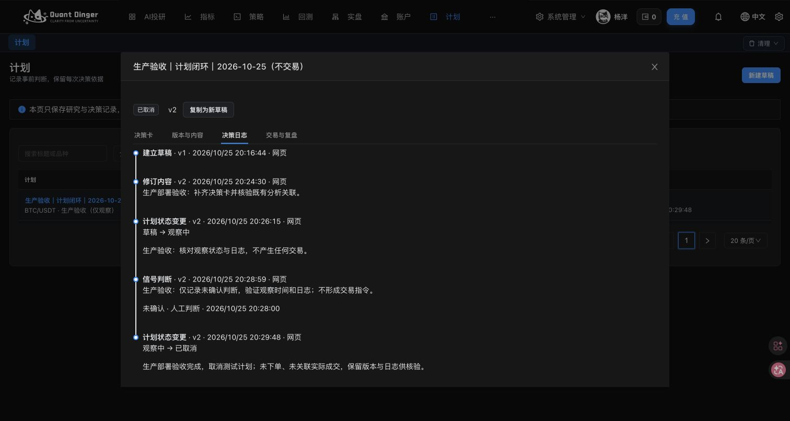

# 计划模块生产部署与验收记录

记录日期：2026-10-25（北京时间）。以下是当日发布与验收快照，不代表后续永久实时状态。

生产入口：https://trade.yangyang.fun/#/trade-plans

结论：合并后的前端、后端、MCP 已部署，计划核心流程生产验收通过。本次未提交订单，未接管持仓，未修改止损或通过业务接口启停策略。验收范围不包含真实下单及实际成交关联的写入。

## 发布版本

| 组件 | 主线提交 | 生产镜像标签 | 部署记录 |
| --- | --- | --- | --- |
| 后端及四类工作进程 | f46c866591901706eb97f75a4cf70a9444f61bfa | manual-f46c866 | [成功记录](https://github.com/YyItRoad/QuantDinger/actions/runs/40191153873) |
| MCP | f46c866591901706eb97f75a4cf70a9444f61bfa | manual-f46c866 | [成功记录](https://github.com/YyItRoad/QuantDinger/actions/runs/40191533614) |
| 前端 | 50620f863e2e22eba2f7a85513e16994196feb33 | manual-50620f8 | [成功记录](https://github.com/YyItRoad/QuantDinger-Vue/actions/runs/40191907620) |

沿用现有生产部署流程和拓扑。后端数据库迁移于 20:01:10 完成；后端健康探测于 20:02:14 通过，MCP 于 20:06:44 通过，前端于 20:10:58 通过，随后 HTTP 探测返回 200。未引入新的 Kafka 或调度拓扑。

## 备份与回退准备

部署前已在服务器 `/opt/quantdinger/backups/plans-20261025-f46c866/` 保存数据库归档及生产配置副本。数据库归档约 8.5M，`pg_restore --list` 可读并返回 1092 行；未执行数据库恢复。

数据库归档 SHA256：`3926386e3afb7492a2d5490182d44563614e3180394ce2c6123016a5db719152`。

未清理旧镜像。旧后端、MCP 标签为 `manual-cd42523`，旧前端标签为 `manual-e3daf75`。回退可恢复旧镜像标签；本次新增表迁移已完成，不能把应用镜像回退等同于数据库回退。生产配置与凭据未写入本报告或代码仓库。

## 网页核心流程验收

验收记录：**生产验收｜计划闭环｜2026-10-25（不交易）**。

计划 ID：`f6332fd5-0371-4792-9dde-cf229bad3705`。

| 操作 | 实际结果 |
| --- | --- |
| 打开计划页面 | 菜单名称为“计划”，深色主题、表单文字及控件正常显示 |
| 20:16:44 创建标题草稿 | 生成 v1，保存成功 |
| 20:24:30 补充决策卡 | 使用现有市场、交易所和品种选择组件，生成 v2；市场 Crypto、合约、BINANCE、BTC/USDT，方向“仅观察” |
| 关联真实分析 | 关联生产已有分析 #855（BTC/USDT，4h，收线时间 20:00）和 #854（BTC/USDT，1h，收线时间 19:00），保留分析快照；未新启动分析任务 |
| 重开修订检查身份字段 | 市场、产品类型、交易所、品种四个选择框禁用；原生合约标识 BTCUSDT 与结算币 USDT 输入框禁用；退出未再次保存 |
| 20:26:15 进入观察 | 状态变为观察中，理由保存成功 |
| 20:28:59 记录判断 | 保存“未确认”及观察时间 20:28:00，理由保存成功 |
| 20:29:48 取消验收计划 | 状态为已取消，保留 v2、历史版本及日志 |
| 决策日志 | 共 5 条：创建、修订、进入观察、未确认判断、取消 |

最终版本 v2、行修订号 5，交易尝试数为 0，没有关联实际成交。测试内容均注明生产验收和不交易；“仅观察”下风险评估为不适用，未填造交易风险参数。

验收记录保留为“已取消”，供用户核对，不删除历史。

## MCP 验收

1. 对实际生产 MCP 容器的 HTTP 端点完成认证、初始化与工具发现，返回 **81 个工具**；包含 `list_trade_plans`、`get_trade_plan`，原有持仓管理工具仍存在。仅检查工具存在，未调用交易或接管写工具。
2. 使用同一部署包启动独立 stdio 验收进程，复用服务器已有有效 Agent 身份读取上述生产计划。返回用户 1、状态 cancelled、版本 2、分析 ID `[855,854]`、事件数 5、交易尝试数 0。
3. stdio 验收进程的传输认证设置仅在该子进程生效；未修改在线 MCP 的认证配置、凭据或权限。首次子进程因混合认证参数校验未通过而退出，调整子进程配置后通过；在线 HTTP 服务健康。
4. 现有连接的 OAuth 身份查询和运行概览读取正常。当前会话客户端缓存的工具目录仍是旧目录，需要重新连接或刷新，才能在该客户端展示新增工具。HTTP 工具发现与 stdio 业务读取分别验证，不将其描述为新增工具已由当前会话连接直接调用。

## 生产运行核对

最终只读核对结果：

- 更新的 7 个容器均 healthy，重启计数均为 0：后端、交易工作进程、调度工作进程、Celery 工作进程、Celery Beat、MCP、前端。
- PostgreSQL、两类 Redis 保持原容器运行，未重建，已运行约 7 天。
- 计划模块的 7 张表已存在。
- 部署前后策略总数 53，运行中实盘策略 3，持仓 4，挂单 0，Agent 模拟订单 0。
- 策略 47、60、62 的运行编号分别仍为 71、84、86，未发生运行编号切换；最终运行租约均有效。
- SQL 再次确认验收计划交易尝试数为 0。

## 验收边界

本次证明生产部署、计划草稿与修订、真实分析关联、身份字段锁定、观察判断、取消和日志闭环，以及 MCP 工具发现和生产记录读取可用。

真实订单提交、实际成交关联写入及所有异常分支未在生产重复执行，不能据此声称这些场景全部经过生产端到端验收。合并前已通过相应 CI 与本地检查。本次未因验收扩大功能或修改代码，也未改动原开发目录中的无关修改。

## 合并前的定向验证

发布前记录：计划、真实认证、关联复盘、开仓原因和真实 MCP stdio 80 项；开仓及原数量、费用、历史、撤单和产品路由 49 项；MCP 全部测试与 Agent 契约 84 项；前端相关交互 56 项，ESLint 和构建通过；Linux 隔离的既有回测权限及实盘回退保护 5 项；后端 Ruff、结构约束和文档检查通过。分组有交叉，不累加总数。这些是当时执行结果，本次文档整理没有重新运行业务测试。

## 生产样例的数据落点

以下为对验收计划 ID 的定向只读查询结果，不是整库总数，也不包含用户另外创建的其他计划：

| 表 | 对应记录数 | 实际含义 |
| --- | --- | --- |
| qd_trade_plans | 1 | 已取消，current_version 指向 v2，row_revision 为 5 |
| qd_trade_plan_versions | 2 | v1 标题草稿；v2 仅观察 BTC/USDT 合约，引用 #855/#854 |
| qd_trade_plan_events | 5 | 创建、修订、进入观察、人工未确认判断、取消 |
| qd_trade_plan_requests | 5 | create、revise、state、decision、state 的幂等响应 |
| qd_trade_plan_attempts | 0 | 未登记交易 |
| qd_trade_plan_links | 0 | 未关联实际成交 |
| qd_trade_plan_reviews | 0 | 未保存交易复盘 |

创建于 20:16:44，修订于 20:24:30，进入观察于 20:26:15；信号实际观察时间 20:28:00，保存时间 20:28:59；取消于 20:29:48。信号记录区分观察时间与服务器记录时间。

用户随后反馈已通过生产 MCP 操作成功；这是用户反馈，不替代上述自动化证据，也不扩大真实下单、成交关联和复盘的生产验收范围。
